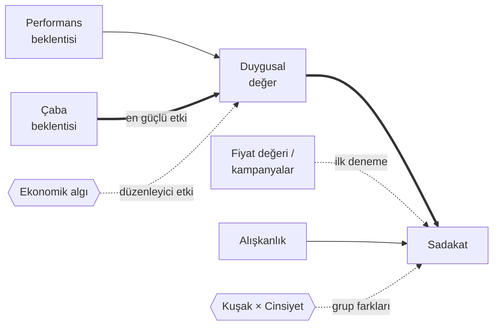

# 🍔 Kuşak Çatışması: Yemek Sipariş Uygulamalarında Alışkanlık, Ekonomik Algı ve Sadakat

<p align="center">
  
  
  
  
  
</p>

**Z kuşağı** ile **X ve Y kuşakları** arasında yemek sipariş uygulamalarına (Yemeksepeti, Getir Yemek, Trendyol Yemek vb.) yönelik **alışkanlık, ekonomik algı ve sadakat** farklılıklarını inceleyen nicel bir araştırma. Eskişehir Osmangazi Üniversitesi Fen Fakültesi İstatistik Bölümü *Anket Düzenleme* dersi kapsamında yürütüldü.

Çalışma, Teknoloji Kabul ve Kullanım Birleştirilmiş Teorisi'ni (**UTAUT2**) temel alıyor ve modeli **Duygusal Değer** ile **Ekonomik Algı** boyutlarıyla genişletiyor.

> 🇬🇧 **In English:** A survey study (n = 239) comparing Generation Z with Generations X/Y in their use of food delivery apps, based on an extended UTAUT2 model with *emotional value* and *economic perception*. Using reliability analysis, t-tests, ANOVA, chi-square, multiple regression and PLS-SEM, it finds that discounts drive first use but **emotional satisfaction drives loyalty**; that Gen Z, contrary to expectations, shows **lower habit scores**; that **effort expectancy** shapes emotional value more than performance expectancy; that economic perception moderates the emotion–loyalty link; and that loyalty differs by gender in opposite directions across generations (a *scissors effect*).

<details>
<summary><b>📑 İçindekiler</b></summary>

- [Temel bulgular](#temel-bulgular)
- [Araştırma modeli](#araştırma-modeli)
- [Yöntem](#yöntem)
- [Ölçek](#ölçek)
- [Repo içeriği](#repo-içeriği)
- [Pazarlama için çıkarımlar](#pazarlama-için-çıkarımlar)
- [Araştırmacılar](#araştırmacılar)

</details>

## Temel bulgular

| | Bulgu |
|---|---|
| 💸 **Fiyat kapıyı açar, duygu içeride tutar** | İndirimler yalnızca ilk denemeyi sağlıyor; sadakati asıl belirleyen rasyonel ucuzluk değil, **duygusal tatmin** |
| 📱 **Z kuşağı "otomatik pilot"ta değil** | Beklenenin aksine, dijital yerli Z kuşağının **alışkanlık skoru diğer kuşaklardan anlamlı derecede düşük** |
| 🪶 **En sevilen uygulama en az yoran uygulamadır** | Çaba beklentisinin (zahmetsizlik) duygusal değer üzerindeki etkisi, performans beklentisinden **çok daha güçlü** |
| 📉 **Ekonomik algı karar mekanizmasını yönetiyor** | Ekonomik algı kötüyken duygusal bağ sadakati etkilemiyor; refah algısı arttıkça **duygusal deneyimin önemi artıyor** |
| ✂️ **Tek tip pazarlama devri bitti** | Cinsiyet ve kuşak arasında bir **"makas etkisi"** var: Z kuşağında kadınlar, diğer kuşaklarda erkekler daha sadık |

## Araştırma modeli



*Kavramsal gösterimdir; kalın oklar bulgularda öne çıkan güçlü ilişkileri, kesikli oklar düzenleyici veya zayıf etkileri temsil eder.*

## Yöntem

| | |
|---|---|
| **Evren** | Türkiye'de yemek sipariş uygulamalarını aktif kullanan 18 yaş ve üzeri bireyler |
| **Örneklem** | 239 geçerli katılımcı (Z kuşağı: 130, diğer kuşaklar: 109) |
| **Örnekleme** | Kartopu ve kolayda örnekleme |
| **Veri toplama** | Google Forms ile çevrimiçi anket (~4 dakika) |
| **Veri kalitesi** | Dikkat kontrol sorusu (KONT14) ile yanıt kalitesinin denetlenmesi |
| **Analizler** | Güvenilirlik analizi, normallik testleri, Ki-kare, t-testi, ANOVA, çoklu regresyon, **PLS-SEM** |

## Ölçek

Ankette 10 demografik / kullanım sorusu ve 7'li Likert tipinde (1 = Hiç katılmıyorum … 7 = Tamamen katılıyorum) 21 ifade yer alıyor:

| Kod | Yapı | İfade sayısı |
|---|---|:---:|
| `PERF` | Performans beklentisi | 3 |
| `CABA` | Çaba beklentisi | 3 |
| `DUYG` | Duygusal değer | 3 |
| `FIY` | Fiyat değeri | 3 |
| `SIN` | Kampanya / indirim etkisi | 1 |
| `ALS` | Alışkanlık | 4 |
| `SAD` | Sadakat | 3 |
| `KONT` | Dikkat kontrolü | 1 |

**Ekonomik algı** katılımcının kendi ekonomik durumunu 1–5 arası puanlamasıyla ölçüldü. Demografik bölümde ayrıca cinsiyet, yaş, eğitim, meslek, şehir, en sık kullanılan uygulama, kullanılan uygulama sayısı ve aylık sipariş sıklığı soruldu.

## Repo içeriği

```
├── Anket Formu.docx     # Uygulanan anketin tam metni (demografik sorular + 21 Likert ifadesi)
├── Kaynakça.docx        # Çalışmada yararlanılan 40 akademik kaynak (APA formatında)
└── README.md
```

> 🔒 **Veri gizliliği:** Katılımcılara verilerin yalnızca bilimsel amaçla kullanılacağı ve kimlik bilgilerinin gizli tutulacağı taahhüt edildiği için ham veri seti etik nedenlerle paylaşılmamıştır.

## Pazarlama için çıkarımlar

- **İndirim tek başına sadakat yaratmıyor.** Kampanya bütçesinin bir kısmı kullanıcı deneyimine (hızlı, net, zahmetsiz sipariş akışı) aktarılmalı.
- **Z kuşağı alışkanlıkla değil, deneyimle bağlanıyor.** Bu kitle için uygulamalar arası geçiş maliyeti düşük; duygusal deneyim ve kolaylık ön planda olmalı.
- **Ekonomik koşullara göre mesaj değişmeli.** Ekonomik algının kötü olduğu dönemlerde fiyat odaklı, iyileştiği dönemlerde deneyim odaklı iletişim daha etkili olabilir.
- **Segment bazlı hedefleme şart.** Kuşak ve cinsiyet kırılımında sadakat farklı işlediği için tek tip kampanyalar verimsiz kalıyor.

## Araştırmacılar

- **Mehmet Emre Ünlü** · [GitHub](https://github.com/Memreu) · [LinkedIn](https://www.linkedin.com/in/memreu)
- **Levent Kasımoğlu**
- **Danışman:** Prof. Dr. Veysel Yılmaz
