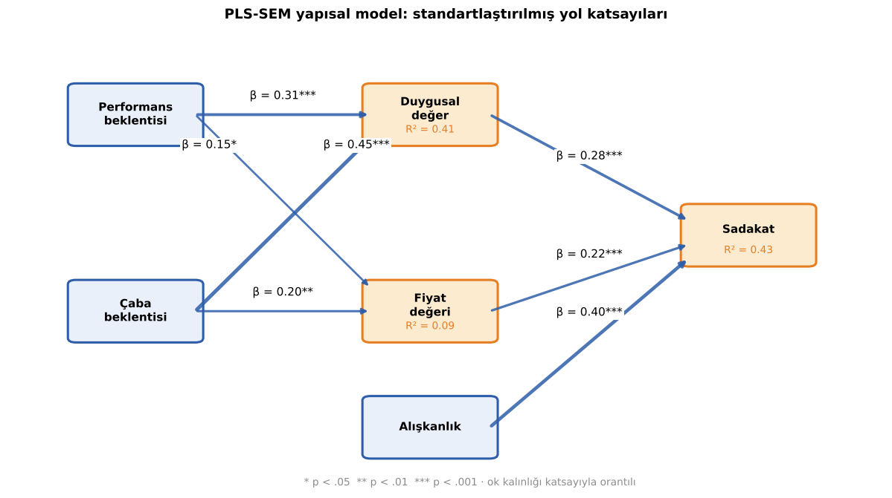
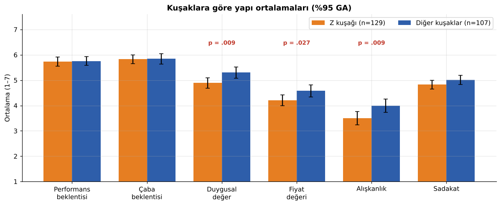
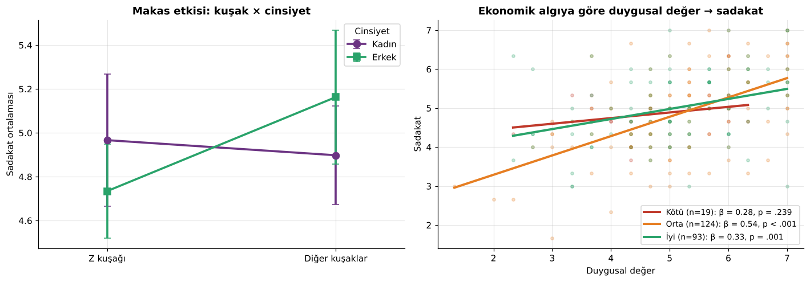
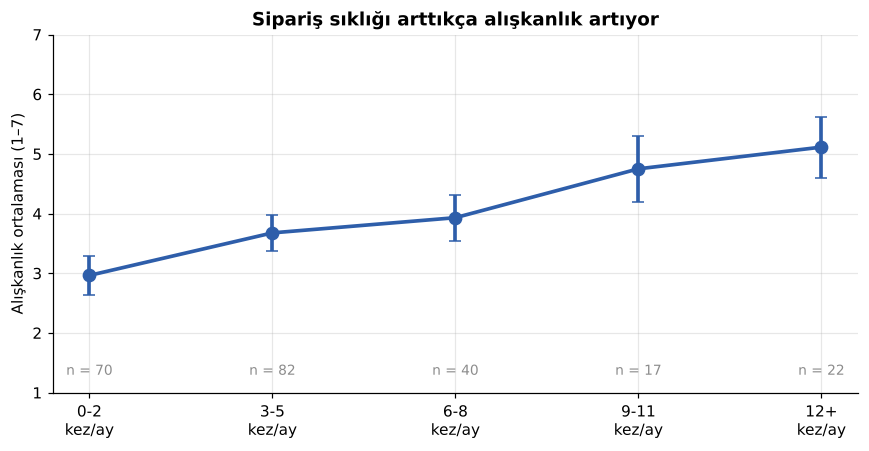
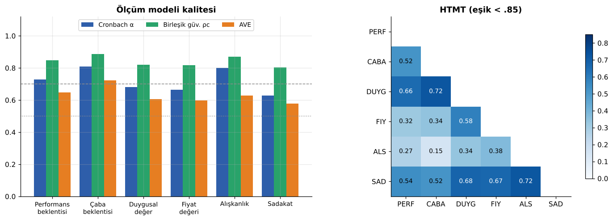
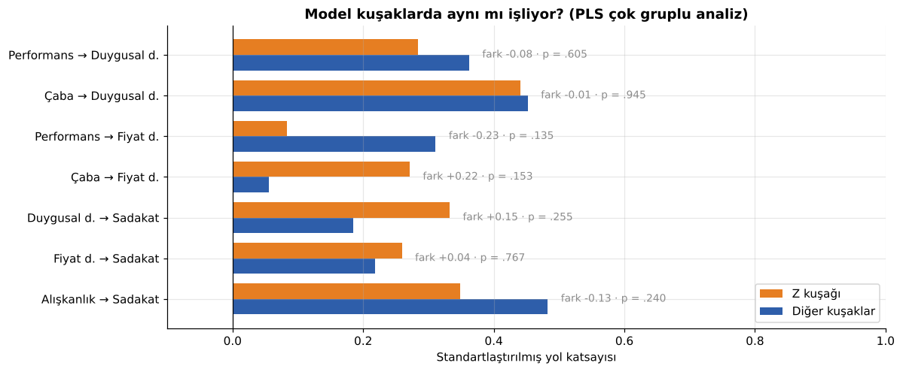
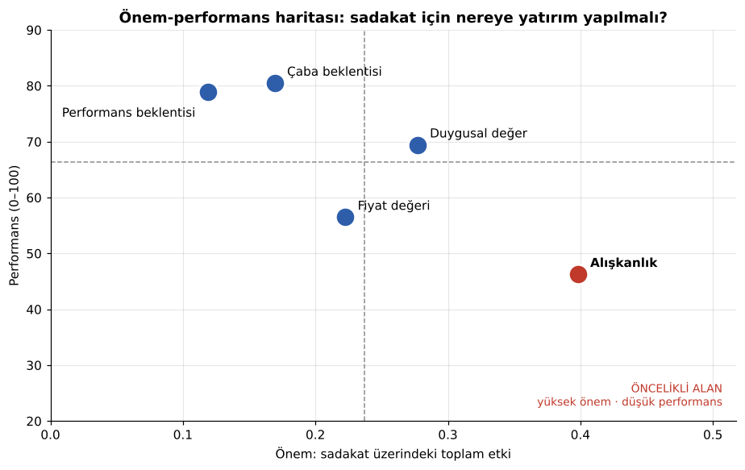

# Kuşak Çatışması: Yemek Sipariş Uygulamalarında Alışkanlık, Ekonomik Algı ve Sadakat

Bu çalışmaya basit bir merakla başladık: yemek sipariş uygulamalarına (Yemeksepeti, Getir Yemek, Trendyol Yemek vb.) en çok bağlı olanın Z kuşağı olduğunu düşünüyorduk. "Dijital yerli" olarak anılan bir kuşağın bu uygulamaları daha alışkanlıkla ve daha sadakatle kullanması beklenir. Eskişehir Osmangazi Üniversitesi Fen Fakültesi İstatistik Bölümü'ndeki Anket Düzenleme dersi kapsamında bu beklentiyi bir anketle sınadık ve sonuç tam tersi çıktı.

Kuramsal çerçeve olarak Teknoloji Kabul ve Kullanım Birleştirilmiş Teorisi'ni (UTAUT2) aldık ve modeli Duygusal Değer ile Ekonomik Algı boyutlarıyla genişlettik. İlk analizleri SPSS ve SmartPLS ile yapmıştık. Bu repoda tüm analizleri Python (PLS-SEM, hipotez testleri) ve R (doğrulayıcı faktör analizi, kovaryans tabanlı SEM, ölçme değişmezliği) ile baştan, herkesin tekrar çalıştırabileceği şekilde yeniden kurdum.



## Ne bulduk

Sadakati en güçlü yordayan yapı alışkanlık (β = 0,40); onu duygusal değer (0,28) ve fiyat değeri (0,22) izliyor. Model sadakatteki varyansın %43'ünü açıklıyor. Duygusal değerin en güçlü öncülü çaba beklentisi (β = 0,45, f² = 0,29); performans beklentisinin etkisi daha zayıf (β = 0,31). Kısacası insanların en sevdiği uygulama, en az yoran uygulama.

Beklentimizin aksine Z kuşağının alışkanlık (3,50 ve 4,00), duygusal değer ve fiyat değeri algısı diğer kuşaklardan anlamlı derecede düşük. Uygulamayı kullanma kolaylığında ise kuşaklar arasında fark yok. Sipariş sıklığı da alışkanlıkla belirgin şekilde ilişkili: ayda 0-2 kez sipariş verenlerin alışkanlık skoru 2,96, 12 ve üzeri kez verenlerinki 5,11 (η² = 0,21).

Ekonomik algı dengeyi değiştiriyor. Ekonomik durumunu kötü algılayanlarda duygusal değerin sadakate etkisi anlamsız, fiyat değerinin etkisi anlamlı; ekonomik algı iyileştikçe fiyatın etkisi en düşük seviyeye iniyor.

Bana göre en ilginç sonuç çok gruplu analizden geldi: hiçbir yol katsayısı kuşaklar arasında anlamlı farklılaşmıyor (tüm p > ,13). Kuşaklar sadakate aynı yoldan ulaşıyor; Z kuşağını ayıran şey bu yolları besleyen algıların daha düşük olması. Önem-performans haritasında alışkanlık sadakate en büyük toplam etkiye (0,40) sahip ama performansı en düşük yapı (100 üzerinden 46); fiyat değeri ikinci öncelikli alan. Bir de kanıt düzeyine ulaşmayan bir eğilim var: Z kuşağında kadınlar, diğer kuşaklarda erkekler daha sadık görünüyor, ancak etkileşim sınırda (p = ,062).

## Hipotez sonuçları

| Hipotez | İlişki | Sonuç | Kanıt |
|---|---|---|---|
| H1a | Performans beklentisi → Duygusal değer | Desteklendi | β = 0,31 [0,18; 0,45], p < ,001 · regresyon 0,29 |
| H1b | Performans beklentisi → Fiyat değeri | Desteklendi (zayıf) | β = 0,15 [0,01; 0,29], p = ,035 · regresyon 0,15 |
| H2a | Çaba beklentisi → Duygusal değer | Desteklendi | β = 0,45 [0,31; 0,58], p < ,001 · regresyon 0,41 |
| H2b | Çaba beklentisi → Fiyat değeri | Desteklendi | β = 0,20 [0,05; 0,34], p = ,009 · regresyon 0,19 |
| H3a | Duygusal değer → Sadakat | Desteklendi | β = 0,28 [0,15; 0,40], p < ,001 · regresyon 0,32 |
| H3b | Fiyat değeri → Sadakat | Desteklendi | β = 0,22 [0,10; 0,35], p = ,001 · regresyon 0,31 |
| H4a | Z kuşağının alışkanlığı daha yüksektir | Reddedildi (ters yönde anlamlı) | 3,50 ve 4,00; t(234) = −2,64, p = ,009 |
| H4b | Kuşaklar arasında sadakat farkı vardır | Reddedildi | p = ,157 |
| H5a | Alışkanlık, duygusal değer → sadakat ilişkisini düzenler | Reddedildi | ΔR² = 0,001, p = ,622 |
| H5b | Alışkanlık, fiyat değeri → sadakat ilişkisini düzenler | Reddedildi | ΔR² = 0,001, p = ,620 |
| H6a | Kötü ekonomik algı, fiyat değerinin etkisini güçlendirir | Kısmen desteklendi | Moderasyon F(2, 230) = 5,88, p = ,003; fiyatın etkisi iyi algıda en zayıf (β = 0,24) |
| H6b | İyi ekonomik algı, duygusal değerin etkisini güçlendirir | Kısmen desteklendi | Moderasyon p = ,029; kötü algıda etki yok, en güçlü etki orta algıda (β = 0,54) |

H1–H3 için verilen değerler PLS-SEM yol katsayıları; köşeli parantezde 2.000 bootstrap örneğiyle %95 güven aralığı var ([`14_pls_sem.md`](results/tablolar/14_pls_sem.md)). Karşılaştırma için ayrı ayrı kurulan standartlaştırılmış çoklu regresyonların β'larını da ekledim ([`10_regresyon.md`](results/tablolar/10_regresyon.md)). Sadakat yollarındaki farkın nedeni, PLS modelinde alışkanlığın da sadakatin yordayıcısı olması; regresyonda H3 yalnızca iki yordayıcıyla kuruldu. Metindeki tüm β'lar PLS-SEM'den.

## Grafikler

Z kuşağı uygulamayı diğer kuşaklar kadar kullanışlı ve kolay buluyor, ancak ondan daha az duygusal ve ekonomik değer algılıyor ve daha az alışkanlık geliştiriyor:



Kuşak × cinsiyet "makas" deseni (solda) ve ekonomik algı gruplarında duygusal değer ile sadakat ilişkisi (sağda):





Ölçüm modelinde tüm yapılarda birleşik güvenilirlik ρc > 0,80 ve AVE > 0,57; HTMT değerlerinin tamamı 0,85 eşiğinin altında (en yüksek 0,72).



## Kuşaklar arası model karşılaştırması

Araştırmanın asıl sorusu "kuşaklar farklı mı?" olduğu için yapısal modeli Z kuşağı ve diğer kuşaklar için ayrı ayrı tahmin ettim ve yol katsayıları arasındaki farkları 1.000 permütasyonla test ettim (PLS-MGA).



Hiçbir yol anlamlı şekilde farklılaşmıyor ve sadakat iki grupta da aynı oranda açıklanıyor (R² = 0,45 ve 0,44). Sayısal eğilimler ilginç ama kanıt düzeyinde değil: Z kuşağında duygusal değerin sadakate etkisi daha güçlü (0,33 ve 0,19), diğer kuşaklarda alışkanlığın etkisi daha güçlü (0,48 ve 0,35). Buradan çıkardığım yorum şu: "kuşak çatışması" sadakatin nasıl oluştuğunda değil, uygulamaya bakışın seviyesinde yaşanıyor.

## Önem-performans haritası

Önem-performans haritası (IPMA), her yapının sadakat üzerindeki toplam etkisini (önem) katılımcıların o yapıyı ne kadar olumlu değerlendirdiğiyle (performans, 0–100) karşılaştırarak iyileştirme önceliklerini gösterir.



| Yapı | Önem (toplam etki) | Performans (0–100) | Çıkarım |
|---|---:|---:|---|
| Alışkanlık | 0,40 | 46 | Öncelikli alan: en etkili ama en zayıf. Tek tıkla tekrar sipariş, abonelik ve seri ödülleri gibi rutin oluşturan özellikler |
| Duygusal değer | 0,28 | 69 | Korunmalı: güçlü ve iyi durumda |
| Fiyat değeri | 0,22 | 57 | İkinci öncelik: özellikle teslimat ücreti algısı |
| Çaba beklentisi | 0,17 | 80 | Hijyen faktörü: zaten yüksek, dolaylı etkili |
| Performans beklentisi | 0,12 | 79 | Hijyen faktörü |

## Örneklem yeterliliği

Güç analizi (α = ,05, güç = ,80), 236 kişilik örneklemin modeldeki testler için gerekenin çok üzerinde olduğunu gösteriyor:

| Test | Orta etki için gereken n | Mevcut n | Saptanabilen en küçük etki |
|---|---:|---:|---|
| Sadakat modeli (3 yordayıcı) | 77 | 236 | f² = 0,047 (küçük-orta arası) |
| Değer modelleri (2 yordayıcı) | 68 | 236 | f² = 0,041 |
| Kuşak karşılaştırması (t-testi) | 128 | 236 (129 + 107) | d = 0,37 |

Örneklem orta büyüklükteki etkileri neredeyse kesin olarak (%97–100 güçle) yakalayabiliyor. Küçük etkiler (f² = 0,02) için ise 500'ü aşkın katılımcı gerekirdi. Bu yüzden anlamlı çıkmayan küçük farkları (ör. kuşaklar arası yol farkları) "etki yok" diye değil, "bu örneklemle saptanamadı" diye okumak gerekiyor.

## Yöntem

| | |
|---|---|
| Evren | Türkiye'de yemek sipariş uygulamalarını aktif kullanan 18 yaş ve üzeri bireyler |
| Örneklem | Dikkat kontrolü, ayrıştırma sorusu ("son 6 ayda sipariş verdiniz mi?") ve tekdüze yanıt filtresi sonrası 236 geçerli katılımcı (Z kuşağı: 129, diğer kuşaklar: 107), 50 il |
| Örnekleme | Kartopu ve kolayda örnekleme; Google Forms ile çevrimiçi anket (~4 dakika) |
| Ölçek | 21 maddelik 7'li Likert: performans (3), çaba (3), duygusal değer (3), fiyat değeri (3), sadakat (3), alışkanlık (4), indirim (1), dikkat kontrolü (1) · [Anket formu](Anket%20Formu.docx) |
| Analizler | Cronbach α, McDonald ω, birleşik güvenilirlik, AVE, HTMT, Fornell-Larcker · χ², t-testi, tek ve iki yönlü ANOVA · çoklu regresyon, moderasyon, bootstrap aracılık · PLS-SEM, çok gruplu PLS (permütasyon), önem-performans haritası · CFA, CB-SEM, ölçme değişmezliği · güç analizi |

Tüm analiz, açıklamaları ve yorumlarıyla birlikte tek bir defterde duruyor: [`notebooks/kusak_analizi.ipynb`](https://nbviewer.org/github/Memreu/kusak-catismasi/blob/main/notebooks/kusak_analizi.ipynb). Defter örneklemden başlayıp ölçüm modeli, kuşak karşılaştırması, PLS-SEM, ekonomik algı, çok gruplu analiz, önem-performans haritası ve güç analizi sırasıyla ilerliyor. nbviewer'da gerçek veriden üretilmiş çıktılarla (yalnızca toplu sonuçlar) okunabilir. [Colab](https://colab.research.google.com/github/Memreu/kusak-catismasi/blob/main/notebooks/kusak_analizi.ipynb)'da da açılıyor; orada ham veri olmadığı için sentetik veriyle çalışır ve sonuçlar biraz farklı çıkar.

## Python ve R tarafı

| Dil | Dosya | Ne yapıyor? |
|---|---|---|
| Python | [`analysis/python/pls_sem.py`](analysis/python/pls_sem.py) | Sıfırdan yazılmış PLS-SEM: Mode A, yol ağırlıklandırma şeması, R², f², ρc, AVE, HTMT, Fornell-Larcker, VIF, bootstrap ile yol ve dolaylı etki testleri. SmartPLS sonuçlarıyla (VIF, f²) birebir uyumlu |
| Python | [`analysis/python/kusak_analiz.py`](analysis/python/kusak_analiz.py) | Tüm hipotez testleri, çok gruplu PLS, önem-performans haritası, güç analizi ve grafikler; sonuçları Markdown tablolarına ve JSON'a yazar |
| Python | [`analysis/python/veri_hazirla.py`](analysis/python/veri_hazirla.py) | SPSS verisini anonim analiz verisine dönüştürür ve sipariş sıklığı kodlarını yanıt tablosuyla doğrular |
| Python | [`analysis/python/sentetik_veri.py`](analysis/python/sentetik_veri.py) | Gizliliği koruyan sentetik veri (Gauss kopula) |
| R | [`analysis/R/cfa_sem.R`](analysis/R/cfa_sem.R) | `lavaan` ile doğrulayıcı faktör analizi, kovaryans tabanlı SEM, dolaylı etkiler ve kuşaklar arası ölçme değişmezliği; `psych` ile güvenilirlik |

İki yöntemi birlikte kullanmamın nedeni şu: PLS-SEM tahmin odaklıdır ve küçük örneklemlerde esnektir; kovaryans tabanlı SEM ise modelin veriye ne kadar uyduğunu test eder. İki yöntemde de yolların yönü aynı, ancak CB-SEM model uyumunun sınırda olduğunu (CFI = 0,85, RMSEA = 0,087) ve performans/çaba → fiyat değeri yollarının bu yöntemde anlamlı olmadığını gösteriyor. Ayrıntılar [`results/R/sonuclar.md`](results/R/sonuclar.md) dosyasında.

## Çalıştırma

```bash
git clone https://github.com/Memreu/kusak-catismasi.git
cd kusak-catismasi

# Python
pip install -r requirements.txt
python analysis/python/kusak_analiz.py        # sentetik veriyle, çıktılar results/sentetik/ altına
jupyter lab notebooks/kusak_analizi.ipynb

# R (lavaan ve psych paketleri gerekir)
Rscript analysis/R/cfa_sem.R                   # çıktılar results/sentetik/R/ altına
```

Ham veriye erişimi olan araştırmacılar `--gercek` bayrağıyla gerçek sonuçları üretebilir; ayrıntılar [`data/README.md`](data/README.md) içinde. Her push'ta iki betik de GitHub Actions'ta sentetik veriyle çalıştırılıyor.

Katılımcılara verilerin yalnızca bilimsel amaçla kullanılacağını ve kimlik bilgilerinin gizli tutulacağını taahhüt ettiğimiz için ham veriyi paylaşmıyorum. Repodaki [`data/sentetik_veri.csv`](data/sentetik_veri.csv), gerçek verinin dağılım ve korelasyon yapısını taklit eden ama hiçbir gerçek katılımcıya karşılık gelmeyen sentetik bir veri seti. `results/` altındaki toplu sonuçlar ise gerçek veriden üretildi.

## Klasör yapısı

```
├── analysis/
│   ├── python/
│   │   ├── pls_sem.py             # PLS-SEM uygulaması (numpy/pandas)
│   │   ├── kusak_analiz.py        # Tüm analizler ve grafikler
│   │   ├── veri_hazirla.py        # SPSS → anonim analiz verisi
│   │   └── sentetik_veri.py       # Gizliliği koruyan sentetik veri
│   └── R/
│       └── cfa_sem.R              # CFA, CB-SEM, ölçme değişmezliği
├── notebooks/
│   └── kusak_analizi.ipynb        # Adım adım analiz (nbviewer / Colab)
├── data/
│   ├── README.md                  # Değişken sözlüğü ve gizlilik notu
│   └── sentetik_veri.csv
├── results/                       # Gerçek veriden üretilmiş toplu sonuçlar
│   ├── tablolar/
│   ├── grafikler/
│   ├── R/sonuclar.md
│   └── sonuclar.json
├── Anket Formu.docx               # Uygulanan anketin tam metni
├── Kaynakça.docx                  # 40 akademik kaynak (APA)
├── requirements.txt
└── .github/workflows/analiz.yml   # Python ve R analizlerinin CI'ı
```

## Sınırlılıklar

Örneklem kartopu ve kolayda örneklemeyle toplandı; katılımcıların yarıdan fazlası öğrenci ve örneklem İstanbul, Eskişehir ve Bursa'da yoğunlaşıyor. Sonuçları Türkiye geneline genellerken dikkatli olmak gerekiyor.

Tasarım kesitsel. Alışkanlık gibi zamanla gelişen yapılar için boylamsal veri daha uygun olurdu ve yol katsayıları nedensellik kanıtı değil.

Duygusal değer, fiyat değeri ve sadakat ölçeklerinin α değerleri 0,60–0,70 arasında ve CB-SEM model uyumu sınırda. Kötü ekonomik algı grubu da küçük (n = 19).

10 yanıt 18 yaş altı katılımcılara ait. Bu yanıtlar çıkarıldığında kuşak farkları anlamlı kalıyor (duyarlılık analizi: [`06b_t_kusak_18_ustu.md`](results/tablolar/06b_t_kusak_18_ustu.md)).

Metrik değişmezlik eşiği çok az aşılıyor (ΔCFI = −0,012); bu yüzden kuşak ortalamalarının karşılaştırılmasını temkinli yorumlamak gerekiyor.

## Araştırmacılar

Mehmet Emre Ünlü ([GitHub](https://github.com/Memreu), [LinkedIn](https://www.linkedin.com/in/memreu)) ve Levent Kasımoğlu. Danışman: Prof. Dr. Veysel Yılmaz.
