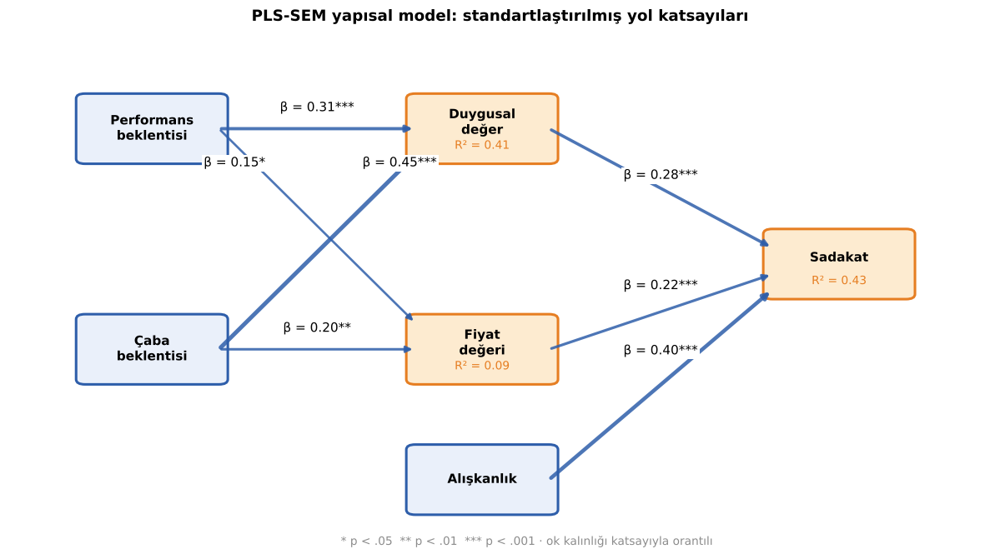
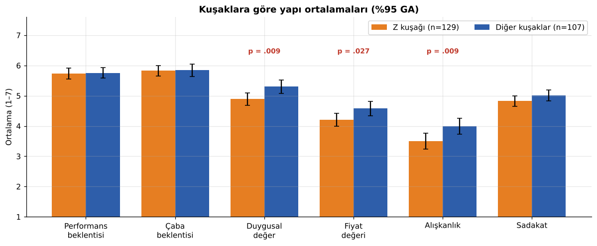
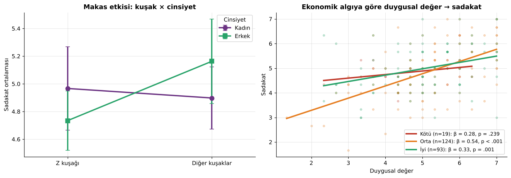
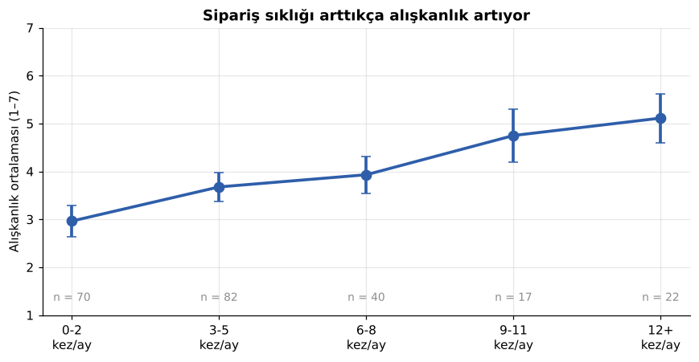
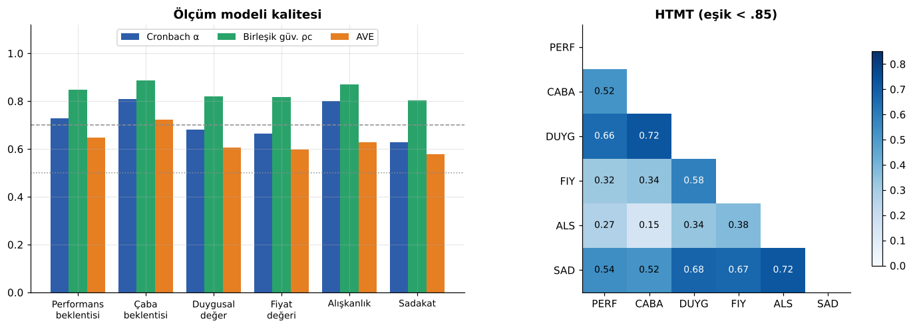
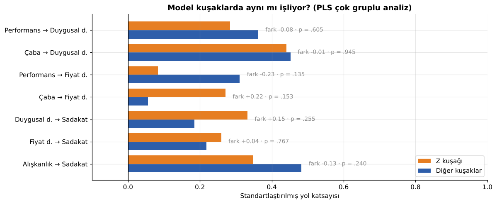
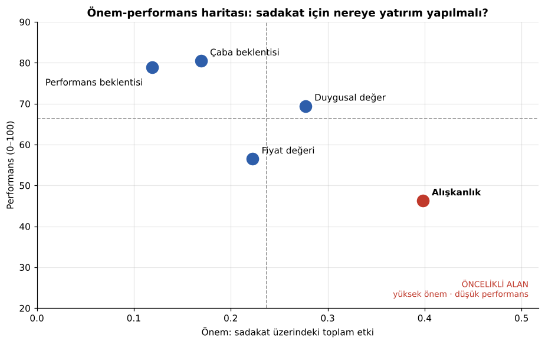

# 🍔 Kuşak Çatışması: Yemek Sipariş Uygulamalarında Alışkanlık, Ekonomik Algı ve Sadakat

<p align="center">
  
  
  
  
  
  <a href="https://github.com/Memreu/Kusak-Catismasi/actions/workflows/analiz.yml"></a>
</p>

<p align="center">
  <a href="https://nbviewer.org/github/Memreu/Kusak-Catismasi/blob/main/notebooks/kusak_analizi.ipynb"></a>
  <a href="https://colab.research.google.com/github/Memreu/Kusak-Catismasi/blob/main/notebooks/kusak_analizi.ipynb"></a>
</p>

**Z kuşağı** ile **X ve Y kuşakları** arasında yemek sipariş uygulamalarına (Yemeksepeti, Getir Yemek, Trendyol Yemek vb.) yönelik **alışkanlık, ekonomik algı ve sadakat** farklılıklarını inceleyen nicel bir araştırma. Eskişehir Osmangazi Üniversitesi Fen Fakültesi İstatistik Bölümü *Anket Düzenleme* dersi kapsamında yürütüldü.

Çalışma, Teknoloji Kabul ve Kullanım Birleştirilmiş Teorisi'ni (**UTAUT2**) temel alıyor ve modeli **Duygusal Değer** ile **Ekonomik Algı** boyutlarıyla genişletiyor. İlk analizler SPSS ve SmartPLS ile yapıldı; bu repoda tüm analizler **Python** (PLS-SEM, hipotez testleri) ve **R** (doğrulayıcı faktör analizi, kovaryans tabanlı SEM, ölçme değişmezliği) ile baştan, açık ve tekrarlanabilir şekilde yeniden kuruldu.

<p align="center"></p>

> 🇬🇧 **In English:** A survey study (n = 236, adequately powered for medium effects) comparing Generation Z with Generations X/Y in their use of food delivery apps, based on an extended UTAUT2 model. All analyses were rebuilt from the original SPSS data in **Python** (a dependency-free PLS-SEM implementation with bootstrapping, t-tests, ANOVA, moderation and mediation) and **R** (lavaan CFA, covariance-based SEM and measurement invariance). Habit is the strongest driver of loyalty (β = 0.40), followed by emotional value and price value; ease of use is the main source of emotional value. Contrary to the "digital native" view, Gen Z reports **lower habit, emotional value and price value** than older generations, and economic perception moderates how much price and emotion translate into loyalty. A permutation-based multi-group PLS analysis shows that the loyalty mechanism itself is the same across generations, and an importance-performance map identifies habit as the top improvement priority. Raw data are not shared to protect participants; a privacy-preserving synthetic dataset lets anyone run the code.

<details>
<summary><b>📑 İçindekiler</b></summary>

- [Temel bulgular](#temel-bulgular)
- [Hipotez sonuçları](#hipotez-sonuçları)
- [Görsel özet](#görsel-özet)
- [Kuşaklar arası model karşılaştırması](#kuşaklar-arası-model-karşılaştırması)
- [Önem-performans haritası](#önem-performans-haritası)
- [Örneklem yeterliliği](#örneklem-yeterliliği)
- [Yöntem](#yöntem)
- [Adım adım notebook](#adım-adım-notebook)
- [İki dilde analiz: Python ve R](#iki-dilde-analiz-python-ve-r)
- [Kurulum ve çalıştırma](#kurulum-ve-çalıştırma)
- [Klasör yapısı](#klasör-yapısı)
- [Sınırlılıklar](#sınırlılıklar)
- [Araştırmacılar](#araştırmacılar)

</details>

## Temel bulgular

| | Bulgu |
|---|---|
| 🔁 **Sadakatin üç motoru** | Sadakati en güçlü yordayan **alışkanlık** (β = 0,40); onu **duygusal değer** (0,28) ve **fiyat değeri** (0,22) izliyor. Model sadakatteki varyansın **%43**'ünü açıklıyor |
| 🪶 **En sevilen uygulama, en az yoran uygulamadır** | Duygusal değerin en güçlü öncülü **çaba beklentisi** (β = 0,45, f² = 0,29); performans beklentisi daha zayıf (β = 0,31) |
| 📱 **Z kuşağı "otomatik pilot"ta değil** | Beklenenin aksine Z kuşağının **alışkanlık** (3,50 vs 4,00), **duygusal değer** ve **fiyat değeri** algısı diğer kuşaklardan anlamlı derecede düşük; uygulamayı kullanma kolaylığında fark yok |
| 📉 **Ekonomik algı dengeyi değiştiriyor** | Ekonomik durumunu kötü algılayanlarda duygusal değerin sadakate etkisi anlamsız, fiyat değerinin etkisi anlamlı. Ekonomik algı iyileştikçe fiyatın etkisi en düşük seviyeye iniyor |
| 🔄 **Sıklık alışkanlık yaratıyor** | Ayda 0-2 kez sipariş verenlerin alışkanlık skoru 2,96, 12+ kez verenlerinki 5,11 (η² = 0,21) |
| ⚖️ **Mekanizma aynı, seviye farklı** | Çok gruplu PLS analizinde hiçbir yol katsayısı kuşaklar arasında anlamlı farklılaşmıyor (tüm p > ,13). Kuşaklar sadakate **aynı yoldan** ulaşıyor; Z kuşağını ayıran şey bu yolları besleyen algıların daha düşük olması |
| 🎯 **Öncelik: alışkanlık** | Önem-performans haritasında alışkanlık sadakate en büyük toplam etkiye (0,40) sahip ama performansı en düşük yapı (100 üzerinden 46). Fiyat değeri ikinci öncelikli alan |
| ✂️ **Makas etkisine dair bir eğilim** | Z kuşağında kadınlar, diğer kuşaklarda erkekler daha sadık; etkileşim sınırda (p = ,062) |

## Hipotez sonuçları

| Hipotez | İlişki | Sonuç | Kanıt |
|---|---|---|---|
| H1a | Performans beklentisi → Duygusal değer | ✅ Desteklendi | β = 0,31 [0,18; 0,45], p < ,001 · regresyon 0,29 |
| H1b | Performans beklentisi → Fiyat değeri | ✅ Desteklendi (zayıf) | β = 0,15 [0,01; 0,29], p = ,035 · regresyon 0,15 |
| H2a | Çaba beklentisi → Duygusal değer | ✅ Desteklendi | β = 0,45 [0,31; 0,58], p < ,001 · regresyon 0,41 |
| H2b | Çaba beklentisi → Fiyat değeri | ✅ Desteklendi | β = 0,20 [0,05; 0,34], p = ,009 · regresyon 0,19 |
| H3a | Duygusal değer → Sadakat | ✅ Desteklendi | β = 0,28 [0,15; 0,40], p < ,001 · regresyon 0,32 |
| H3b | Fiyat değeri → Sadakat | ✅ Desteklendi | β = 0,22 [0,10; 0,35], p = ,001 · regresyon 0,31 |
| H4a | Z kuşağının alışkanlığı daha yüksektir | ❌ Reddedildi (**ters yönde** anlamlı) | 3,50 vs 4,00; t(234) = −2,64, p = ,009 |
| H4b | Kuşaklar arasında sadakat farkı vardır | ❌ Reddedildi | p = ,157 |
| H5a | Alışkanlık, duygusal değer → sadakat ilişkisini düzenler | ❌ Reddedildi | ΔR² = 0,001, p = ,622 |
| H5b | Alışkanlık, fiyat değeri → sadakat ilişkisini düzenler | ❌ Reddedildi | ΔR² = 0,001, p = ,620 |
| H6a | Kötü ekonomik algı, fiyat değerinin etkisini güçlendirir | 🟡 Kısmen desteklendi | Moderasyon F(2, 230) = 5,88, p = ,003; fiyatın etkisi iyi algıda en zayıf (β = 0,24) |
| H6b | İyi ekonomik algı, duygusal değerin etkisini güçlendirir | 🟡 Kısmen desteklendi | Moderasyon p = ,029; kötü algıda etki yok, en güçlü etki orta algıda (β = 0,54) |

H1–H3: PLS-SEM yol katsayıları, köşeli parantezde 2.000 bootstrap örneğiyle %95 güven aralığı ([`14_pls_sem.md`](results/tablolar/14_pls_sem.md)). Karşılaştırma için ayrı ayrı kurulan standartlaştırılmış çoklu regresyonların β'ları da verildi ([`10_regresyon.md`](results/tablolar/10_regresyon.md)). Sadakat yollarında farkın nedeni, PLS modelinde alışkanlığın da sadakatin yordayıcısı olması; regresyonda H3 yalnızca iki yordayıcıyla kuruldu. Bulgular bölümündeki tüm β'lar PLS-SEM'den.

## Görsel özet

**Kuşak farkları:** Z kuşağı uygulamayı diğer kuşaklar kadar kullanışlı ve kolay buluyor, ancak ondan daha az duygusal ve ekonomik değer algılıyor ve daha az alışkanlık geliştiriyor.

<p align="center"></p>

**Etkileşimler:** Kuşak × cinsiyet "makas" deseni (solda) ve ekonomik algı gruplarında duygusal değer ile sadakat ilişkisi (sağda).

<p align="center"></p>

<p align="center">
  
</p>

**Ölçüm modeli:** Tüm yapılarda birleşik güvenilirlik ρc > 0,80 ve AVE > 0,57; HTMT değerlerinin tamamı 0,85 eşiğinin altında (en yüksek 0,72).

<p align="center"></p>

## Kuşaklar arası model karşılaştırması

Araştırmanın asıl sorusu "kuşaklar farklı mı?" olduğu için yapısal model Z kuşağı ve diğer kuşaklar için ayrı ayrı tahmin edildi ve yol katsayıları arasındaki farklar 1.000 permütasyonla test edildi (PLS-MGA).

<p align="center"></p>

- **Hiçbir yol anlamlı şekilde farklılaşmıyor.** Sadakat iki grupta da aynı oranda açıklanıyor (R² = 0,45 ve 0,44).
- Sayısal eğilimler ilginç ama kanıt düzeyinde değil: Z kuşağında duygusal değerin sadakate etkisi daha güçlü (0,33 vs 0,19), diğer kuşaklarda alışkanlığın etkisi daha güçlü (0,48 vs 0,35).
- **Yorum:** "Kuşak çatışması" sadakatin nasıl oluştuğunda değil, uygulamaya bakışın seviyesinde yaşanıyor. Z kuşağı aynı mekanizmayla çalışıyor ama duygusal değer, fiyat değeri ve alışkanlık algısı daha düşük.

## Önem-performans haritası

Önem-performans haritası (IPMA), her yapının sadakat üzerindeki toplam etkisini (önem) katılımcıların o yapıyı ne kadar olumlu değerlendirdiğiyle (performans, 0–100) karşılaştırarak iyileştirme önceliklerini gösterir.

<p align="center"></p>

| Yapı | Önem (toplam etki) | Performans (0–100) | Çıkarım |
|---|---:|---:|---|
| Alışkanlık | 0,40 | 46 | 🔴 **Öncelikli alan:** en etkili ama en zayıf. Tek tıkla tekrar sipariş, abonelik ve seri ödülleri gibi rutin oluşturan özellikler |
| Duygusal değer | 0,28 | 69 | 🟢 Korunmalı: güçlü ve iyi durumda |
| Fiyat değeri | 0,22 | 57 | 🟠 İkinci öncelik: özellikle teslimat ücreti algısı |
| Çaba beklentisi | 0,17 | 80 | ⚪ Hijyen faktörü: zaten yüksek, dolaylı etkili |
| Performans beklentisi | 0,12 | 79 | ⚪ Hijyen faktörü |

## Örneklem yeterliliği

Güç analizi (α = ,05, güç = ,80), 236 kişilik örneklemin modeldeki testler için gerekenin çok üzerinde olduğunu gösteriyor:

| Test | Orta etki için gereken n | Mevcut n | Saptanabilen en küçük etki |
|---|---:|---:|---|
| Sadakat modeli (3 yordayıcı) | 77 | 236 | f² = 0,047 (küçük-orta arası) |
| Değer modelleri (2 yordayıcı) | 68 | 236 | f² = 0,041 |
| Kuşak karşılaştırması (t-testi) | 128 | 236 (129 + 107) | d = 0,37 |

Örneklem orta büyüklükteki etkileri neredeyse kesin olarak (%97–100 güçle) yakalayabiliyor. Küçük etkiler (f² = 0,02) için ise 500'ü aşkın katılımcı gerekirdi; bu yüzden anlamlı çıkmayan küçük farklar (ör. kuşaklar arası yol farkları) "etki yok" değil, "bu örneklemle saptanamadı" şeklinde yorumlanmalı.

## Yöntem

| | |
|---|---|
| **Evren** | Türkiye'de yemek sipariş uygulamalarını aktif kullanan 18 yaş ve üzeri bireyler |
| **Örneklem** | Dikkat kontrolü, ayrıştırma sorusu ("son 6 ayda sipariş verdiniz mi?") ve tekdüze yanıt filtresi sonrası **236 geçerli katılımcı** (Z kuşağı: 129, diğer kuşaklar: 107), 50 il |
| **Örnekleme** | Kartopu ve kolayda örnekleme; Google Forms ile çevrimiçi anket (~4 dakika) |
| **Ölçek** | 21 maddelik 7'li Likert: performans (3), çaba (3), duygusal değer (3), fiyat değeri (3), sadakat (3), alışkanlık (4), indirim (1), dikkat kontrolü (1) · [Anket formu](Anket%20Formu.docx) |
| **Analizler** | Cronbach α, McDonald ω, birleşik güvenilirlik, AVE, HTMT, Fornell-Larcker · χ², t-testi, tek ve iki yönlü ANOVA · çoklu regresyon, moderasyon, bootstrap aracılık · PLS-SEM, çok gruplu PLS (permütasyon), önem-performans haritası · CFA, CB-SEM, ölçme değişmezliği · güç analizi |

## Adım adım notebook

Tüm analiz, açıklamaları ve yorumlarıyla birlikte tek bir defterde: [`notebooks/kusak_analizi.ipynb`](https://nbviewer.org/github/Memreu/Kusak-Catismasi/blob/main/notebooks/kusak_analizi.ipynb)

| # | Bölüm | Soru |
|---|---|---|
| 1 | Örneklem | Kimlerle konuştuk? |
| 2 | Ölçüm modeli | Ölçekler güvenilir ve birbirinden ayrışıyor mu? |
| 3 | Kuşak karşılaştırması | Z kuşağı hangi algılarda farklı? |
| 4 | Yapısal model (PLS-SEM) | Sadakati ne belirliyor? |
| 5 | Ekonomik algı | Refah algısı duygu ve fiyatın etkisini değiştiriyor mu? |
| 6 | Çok gruplu analiz | Sadakat mekanizması kuşaklarda aynı mı? |
| 7 | Önem-performans haritası | Sadakat için nereye yatırım yapılmalı? |
| 8 | Güç analizi | 236 kişi yeterli mi? |

- 📓 **[nbviewer](https://nbviewer.org/github/Memreu/Kusak-Catismasi/blob/main/notebooks/kusak_analizi.ipynb)'da** gerçek veriden üretilmiş çıktılarla okunabilir (yalnızca toplu sonuçlar).
- ☁️ **[Colab](https://colab.research.google.com/github/Memreu/Kusak-Catismasi/blob/main/notebooks/kusak_analizi.ipynb)'da** tek tıkla çalışır; ham veri paylaşılmadığı için orada sentetik veriyle çalışır ve sonuçlar biraz farklı çıkar.

## İki dilde analiz: Python ve R

| Dil | Dosya | Ne yapıyor? |
|---|---|---|
| 🐍 Python | [`analysis/python/pls_sem.py`](analysis/python/pls_sem.py) | Sıfırdan yazılmış PLS-SEM: Mode A, yol ağırlıklandırma şeması, R², f², ρc, AVE, HTMT, Fornell-Larcker, VIF, bootstrap ile yol ve dolaylı etki testleri. SmartPLS sonuçlarıyla (VIF, f²) birebir uyumlu |
| 🐍 Python | [`analysis/python/kusak_analiz.py`](analysis/python/kusak_analiz.py) | Tüm hipotez testleri, çok gruplu PLS, önem-performans haritası, güç analizi ve grafikler; sonuçları Markdown tablolarına ve JSON'a yazar |
| 🐍 Python | [`analysis/python/veri_hazirla.py`](analysis/python/veri_hazirla.py) | SPSS verisini anonim analiz verisine dönüştürür ve sipariş sıklığı kodlarını yanıt tablosuyla doğrular |
| 🐍 Python | [`analysis/python/sentetik_veri.py`](analysis/python/sentetik_veri.py) | Gizliliği koruyan sentetik veri (Gauss kopula) |
| 📊 R | [`analysis/R/cfa_sem.R`](analysis/R/cfa_sem.R) | `lavaan` ile doğrulayıcı faktör analizi, kovaryans tabanlı SEM, dolaylı etkiler ve kuşaklar arası ölçme değişmezliği; `psych` ile güvenilirlik |

**Neden iki yöntem?** PLS-SEM tahmin odaklıdır ve küçük örneklemlerde esnektir; kovaryans tabanlı SEM ise modelin veriye ne kadar uyduğunu test eder. İki yöntemde de yolların yönü aynı, ancak CB-SEM model uyumunun sınırda olduğunu (CFI = 0,85, RMSEA = 0,087) ve performans/çaba → fiyat değeri yollarının bu yöntemde anlamlı olmadığını gösteriyor. Ayrıntılar: [`results/R/sonuclar.md`](results/R/sonuclar.md).

## Kurulum ve çalıştırma

```bash
git clone https://github.com/Memreu/Kusak-Catismasi.git
cd Kusak-Catismasi

# Python
pip install -r requirements.txt
python analysis/python/kusak_analiz.py        # sentetik veriyle → results/sentetik/
jupyter lab notebooks/kusak_analizi.ipynb     # adım adım defter

# R (lavaan ve psych paketleri gerekir)
Rscript analysis/R/cfa_sem.R                   # sentetik veriyle → results/sentetik/R/
```

Ham veriye erişimi olan araştırmacılar `--gercek` bayrağıyla gerçek sonuçları üretebilir; bkz. [`data/README.md`](data/README.md). Her push'ta iki betik de GitHub Actions'ta sentetik veriyle çalıştırılır.

> 🔒 **Veri gizliliği:** Katılımcılara verilerin yalnızca bilimsel amaçla kullanılacağı ve kimlik bilgilerinin gizli tutulacağı taahhüt edildiği için ham veri paylaşılmaz. Repodaki [`data/sentetik_veri.csv`](data/sentetik_veri.csv), gerçek verinin dağılım ve korelasyon yapısını taklit eden ancak hiçbir gerçek katılımcıya karşılık gelmeyen sentetik bir veri setidir. Yalnızca toplu sonuçlar (`results/`) gerçek veriden üretilmiştir.

## Klasör yapısı

```
├── analysis/
│   ├── python/
│   │   ├── pls_sem.py             # PLS-SEM uygulaması (numpy/pandas)
│   │   ├── kusak_analiz.py        # Tüm analizler ve grafikler
│   │   ├── veri_hazirla.py        # SPSS → anonim analiz verisi
│   │   └── sentetik_veri.py       # Gizliliği koruyan sentetik veri
│   └── R/
│       └── cfa_sem.R              # CFA, CB-SEM, ölçme değişmezliği
├── notebooks/
│   └── kusak_analizi.ipynb        # Adım adım analiz (nbviewer / Colab)
├── data/
│   ├── README.md                  # Değişken sözlüğü ve gizlilik notu
│   └── sentetik_veri.csv
├── results/                       # Gerçek veriden üretilmiş toplu sonuçlar
│   ├── tablolar/                  # Sonuç tabloları (Markdown)
│   ├── grafikler/
│   ├── R/sonuclar.md
│   └── sonuclar.json
├── Anket Formu.docx               # Uygulanan anketin tam metni
├── Kaynakça.docx                  # 40 akademik kaynak (APA)
├── requirements.txt
└── .github/workflows/analiz.yml   # Python ve R analizlerinin CI'ı
```

## Sınırlılıklar

- **Örneklem:** Kartopu ve kolayda örnekleme; katılımcıların yarıdan fazlası öğrenci ve örneklem İstanbul, Eskişehir ve Bursa'da yoğunlaşıyor. Sonuçlar Türkiye geneline genellenirken dikkatli olunmalı.
- **Kesitsel tasarım:** Alışkanlık gibi zamanla gelişen yapılar için boylamsal veri daha uygun olur; yol katsayıları nedensellik kanıtı değildir.
- **Ölçüm:** Duygusal değer, fiyat değeri ve sadakat ölçeklerinin α değerleri 0,60–0,70 arasında; CB-SEM model uyumu sınırda. Kötü ekonomik algı grubu küçük (n = 19).
- **Yaş:** 10 yanıt 18 yaş altı katılımcılara ait; bu yanıtlar çıkarıldığında kuşak farkları anlamlı kalıyor (duyarlılık analizi: [`06b_t_kusak_18_ustu.md`](results/tablolar/06b_t_kusak_18_ustu.md)).
- **Ölçme değişmezliği:** Metrik değişmezlik eşiği çok az aşılıyor (ΔCFI = −0,012); kuşak ortalamalarının karşılaştırılması temkinli yorumlanmalı.

## Araştırmacılar

- **Mehmet Emre Ünlü** · [GitHub](https://github.com/Memreu) · [LinkedIn](https://www.linkedin.com/in/memreu)
- **Levent Kasımoğlu**
- **Danışman:** Prof. Dr. Veysel Yılmaz
